<p align="center">
  
</p>

<h1 align="center">MacSentry — free, open-source disk cleaner and storage analyzer for macOS</h1>

<p align="center">
  <a href="LICENSE"></a>
  
  
  <a href="CONTRIBUTING.md"></a>
  <a href="https://github.com/ulvxa/macsentry/releases/latest"></a>
</p>

<p align="center">
  MacSentry is a native Mac storage cleaner that scans your disk, shows where your space went, and finds what is safe to clean up: Xcode DerivedData, <code>node_modules</code>, Homebrew and npm caches, app caches, leftover files from uninstalled apps, duplicate files and old large downloads. It never deletes anything on its own. The files you pick move to a quarantine folder, and they go to the Trash only when you say so.
</p>

<p align="center">
  <a href="https://github.com/ulvxa/macsentry/releases/latest"><b>Download</b></a> ·
  <a href="#-install">Install</a> ·
  <a href="#-how-it-works">How it works</a> ·
  <a href="#-safety-guarantees">Safety</a> ·
  <a href="#-faq">FAQ</a> ·
  <a href="CONTRIBUTING.md">Contribute</a>
</p>

---

> [!NOTE]
> **Free and open source.** MacSentry is free, MIT licensed, and stays that way. There are no accounts, ads or telemetry, and the app makes no network requests. It is built in the open and community contributions are welcome.
>
> **No warranty.** MacSentry is careful by design, but it is provided as is. Review what you quarantine before you move it to the Trash.

<p align="center">
  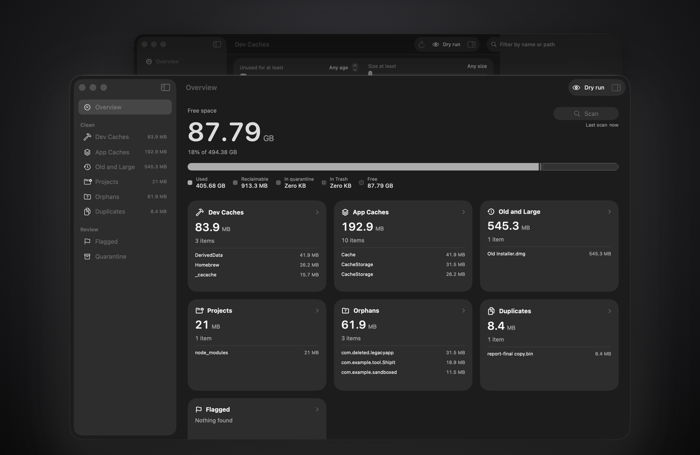
</p>

## 🧹 Free up space on your Mac safely

Clean up Mac storage without guessing what is safe to remove. Every item MacSentry finds comes with a safety tier, the reason it is reclaimable, and the rule that matched it. Nothing leaves your disk until you move it from quarantine to the Trash yourself.

**Why MacSentry?** It is a free, open-source alternative to paid Mac cleaners and disk space analyzers such as CleanMyMac, DaisyDisk and OmniDiskSweeper. The main differences are a quarantine step before the Trash, rules stored as readable JSON, and special handling for developer caches.

## ✨ What MacSentry cleans

- **Developer caches.** Xcode DerivedData, simulator caches, Xcode device support, Gradle, npm, Yarn, Bun, pip, Cargo, SwiftPM, CocoaPods, Homebrew and more.
- **App caches.** Chromium and Electron caches nested deep inside apps (Chrome, Notion, Figma, VS Code, Slack style apps), `~/Library/Caches`, sandboxed container caches and updater downloads, grouped per app.
- **Old and large files.** Big files you have not opened in a while, with adjustable age and size thresholds. Old `.dmg` and `.pkg` installers in Downloads are included.
- **Old project build folders.** Lists code projects you have not touched in a while along with their rebuildable folders: `node_modules`, `.venv`, Rust `target`, `DerivedData`, `.build`, Unity `Library`, `Pods` and others. Source code and `.git` are never candidates.
- **Leftovers from uninstalled apps.** `~/Library` folders left behind by apps you already removed, each with a confidence level, plus settings folders from older app versions.
- **Duplicate files.** Identical files matched by SHA-256. APFS clones are recognized, hard links are ignored, and one copy is always kept.
- **Flagged storage hogs.** Docker's disk image, Ollama models, iOS simulators, Android system images, VMs, Steam games and iOS backups. MacSentry never moves these. It shows their size and a CLI command you can copy so the owning tool does the cleanup.

It also includes:

- **A disk space analyzer.** It reports true sizes (logical, allocated and actually freeable bytes), so APFS clones, hard links and sparse files are not double counted. A treemap of the scanned disk lets you drill down.
- **A menu bar disk monitor.** It shows free space, a 30-day sparkline, quarantine and Trash totals, and can send a low disk space notification.
- **Your own settings.** Never-touch patterns, ignored items, per-app profile toggles and adjustable thresholds.
- **A native app.** Swift 6, SwiftUI and macOS 26 Liquid Glass. The UI is black and white, and safety tiers are told apart by shape, not color.

### Screenshots

| | |
|:---:|:---:|
| 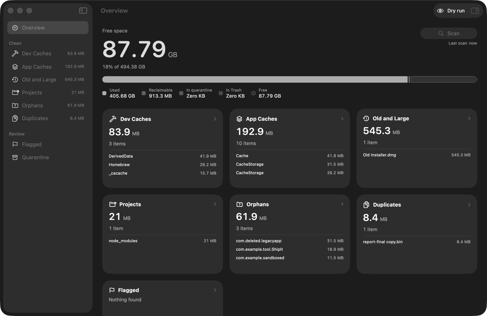<br>**Overview** | 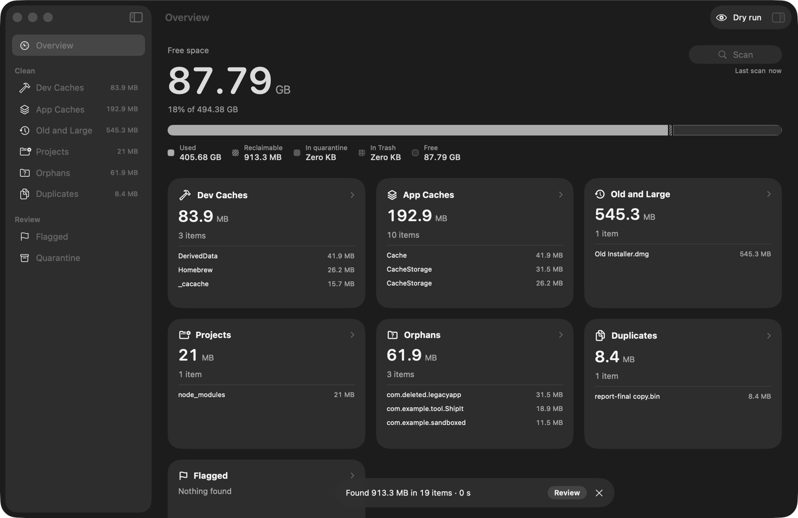<br>**Scanning** |
| 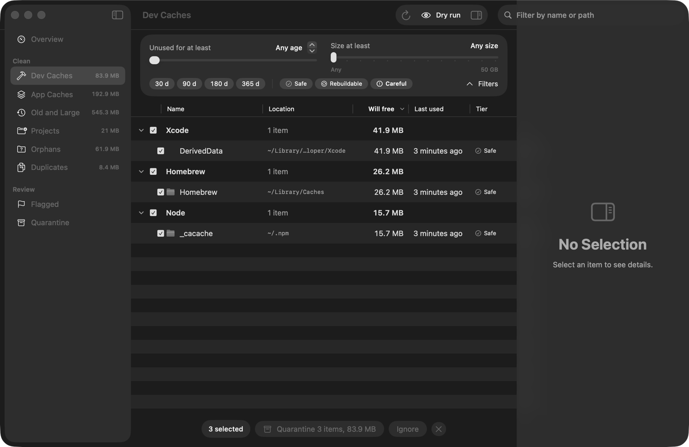<br>**Dev Caches** | 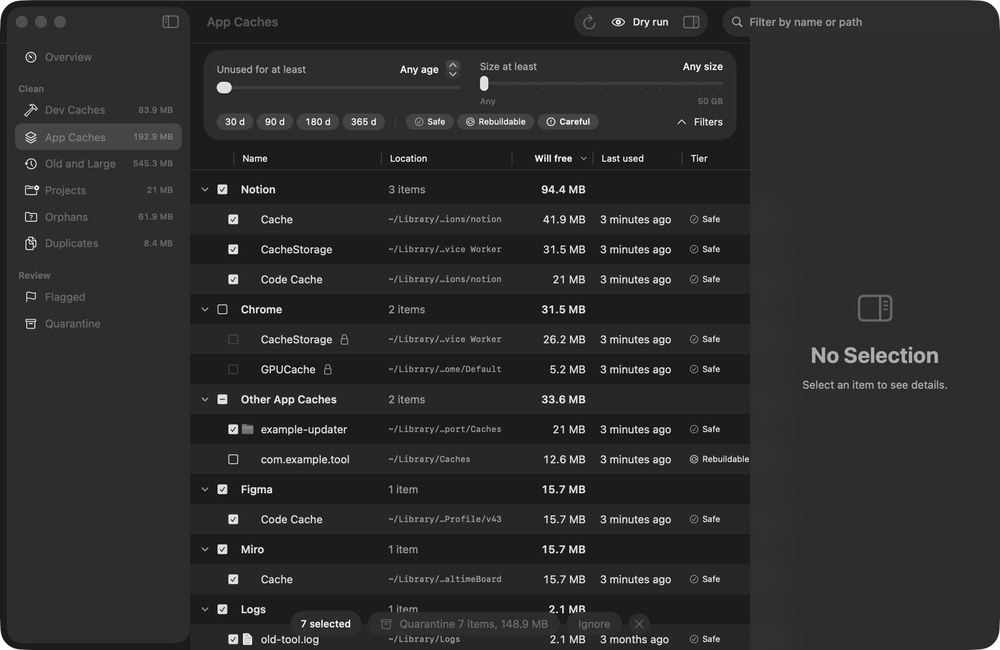<br>**App Caches** |
| 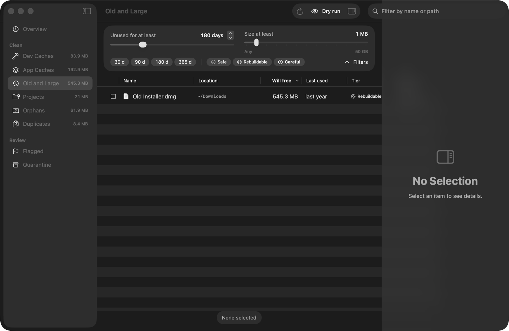<br>**Old and Large** | 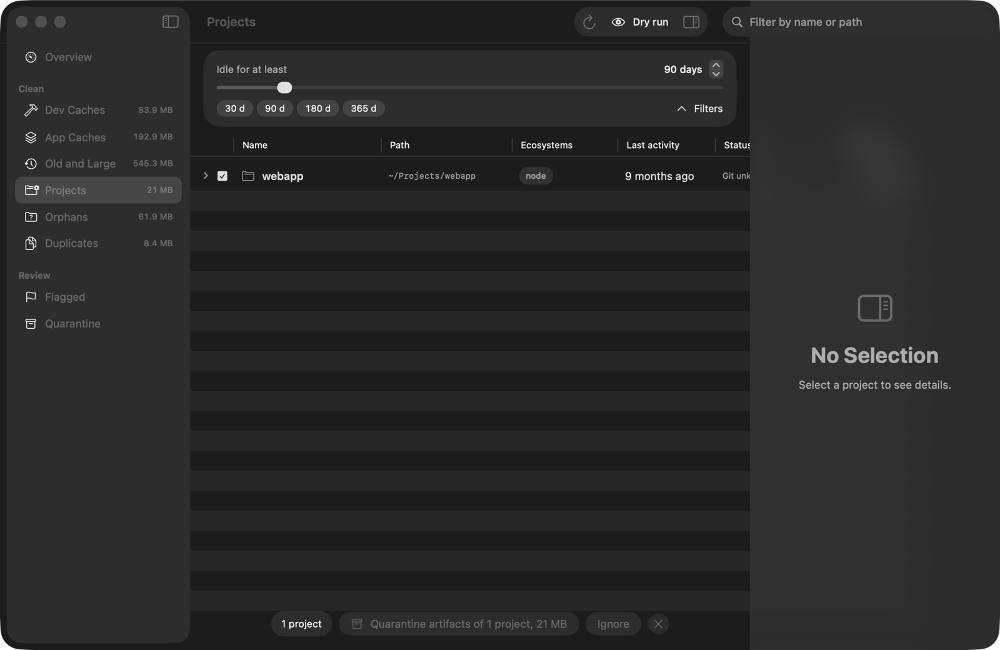<br>**Projects** |
| 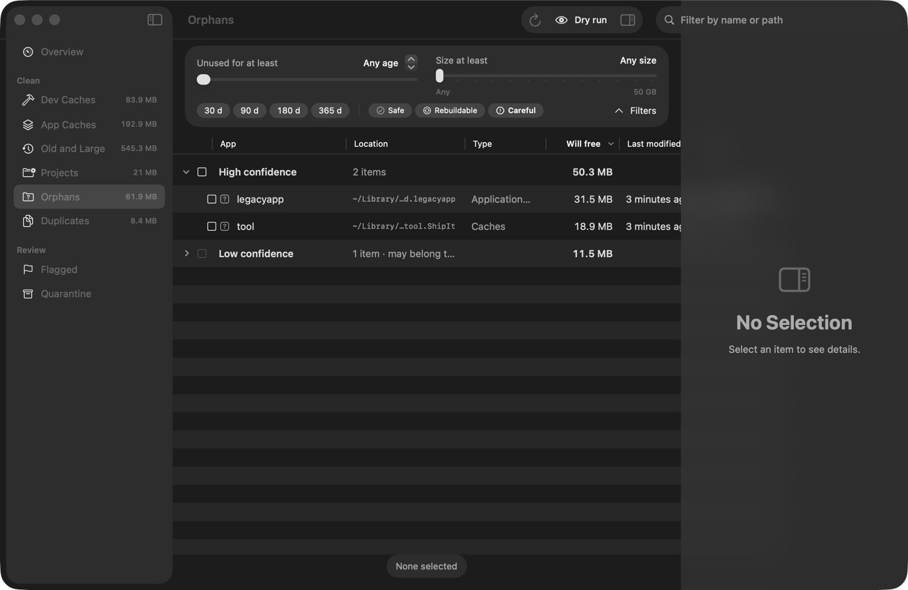<br>**Orphans** | 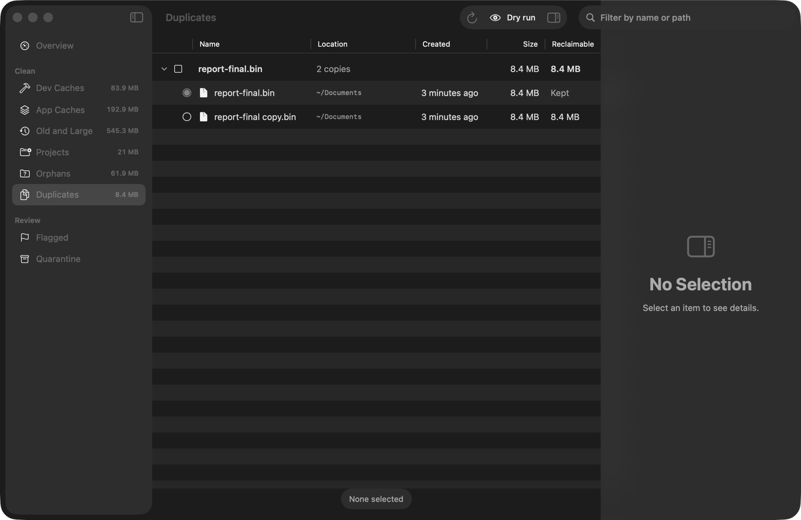<br>**Duplicates** |

## 🎬 See it in action

<p align="center">
  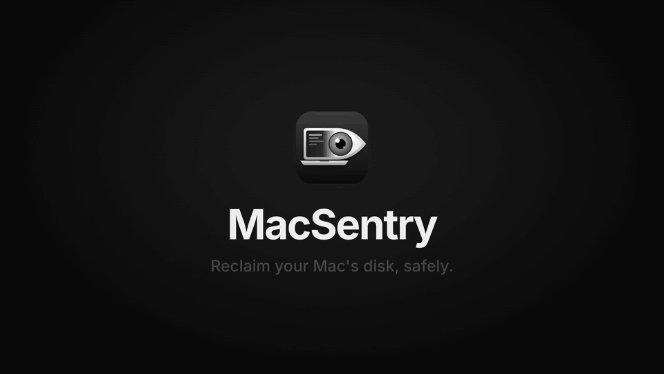
</p>

The full walkthrough video is attached to the [latest release](https://github.com/ulvxa/macsentry/releases/latest).

## 🔍 How it works

<p align="center">
  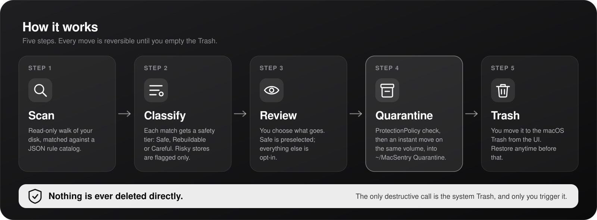
</p>

1. **Scan.** MacSentry walks the disk once using `getattrlistbulk`. It never follows symlinks and never leaves the volume. Each file and folder is checked against a data-driven rule catalog, the project scanner, the orphan detector and the duplicate finder.
2. **Review.** Each candidate gets a safety tier, a reason and the rule that matched it. Only Safe items are preselected.
3. **Quarantine.** Picked items are renamed into `~/MacSentry Quarantine/<batch>/`, keeping their original folder structure. The move stays on the same volume, so it is instant. Each batch writes a `manifest.json` recording what moved where, and Restore puts items back.
4. **Trash.** When you are sure, Move to Trash sends quarantined items to the macOS Trash. Emptying the Trash is up to you.

### Safety tiers

<p align="center">
  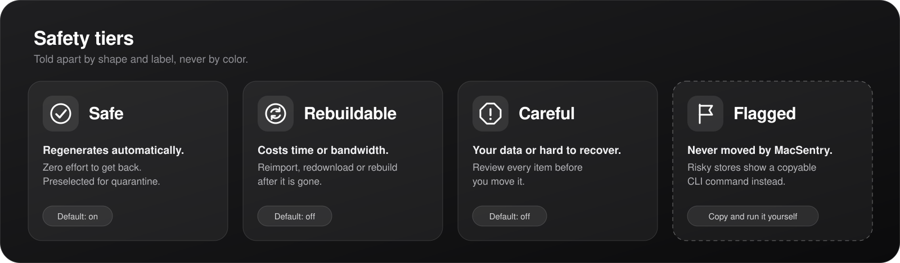
</p>

| Tier | Meaning | Preselected |
|---|---|---|
| **Safe** | Regenerates automatically, zero effort | Yes |
| **Rebuildable** | Comes back, but costs time or bandwidth (redownload, reimport, rebuild) | No |
| **Careful** | Your data or hard to recover. Review every item | No |

## 🛡 Safety guarantees

These rules are enforced in code and review:

- **Nothing is deleted directly.** `removeItem` is banned everywhere, and a custom SwiftLint rule fails CI if it ever appears. The only destructive call is `FileManager.trashItem`, inside `QuarantineService`.
- **Every move is checked first.** `ProtectionPolicy.check` runs before each move. It denies system folders, apps, keychains, Mail, Messages, iCloud, SSH/GPG/cloud credentials, crypto wallets, photo and music libraries, `.git` directories, source files in git working trees, top-level home folders, and your own never-touch patterns.
- **Items are rechecked at move time.** MacSentry refuses to move an item that vanished, changed size, became a symlink or is locked, or that belongs to an app that is still running, and it shows you the reason.
- **Nothing is copied across volumes.** If a move would cross devices, it fails instead of falling back to copy and delete.
- **Risky stores are flag only.** Docker, Ollama, simulators, Android SDK images, VMs, Steam games and iOS backups get a CLI command, never a move.
- **You can recover.** Quarantine manifests survive a lost database, and Restore refuses to overwrite anything that is now at the original path.
- **A dry run mode is available for development.** Nothing moves on disk.

## 📦 Install

1. Download `MacSentry-0.1.0.dmg` from the [latest release](https://github.com/ulvxa/macsentry/releases/latest).
2. Open it and drag **MacSentry** into **Applications**.
3. **First launch:** the build is not notarized yet, so macOS blocks a normal double click. Right-click MacSentry in Applications and choose **Open**, or go to **System Settings > Privacy & Security** and click **Open Anyway**.
4. **Grant Full Disk Access.** MacSentry asks on first launch and opens the right pane for you. Without it, folders like `~/Library/Containers`, Mail and iOS backups cannot be read. You can also continue with a limited scan.

**Requirements:** macOS 26 (Tahoe) or later, Apple Silicon.

## 🛠 Build from source

Requires Xcode 26 and Homebrew.

```bash
brew install xcodegen swiftlint swiftformat
git clone https://github.com/ulvxa/macsentry.git
cd macsentry
xcodegen generate
open MacSentry.xcodeproj
```

Set your own signing team in `project.yml` (`DEVELOPMENT_TEAM`) before building. Full Disk Access is tied to the code signature, so sign every build with the same certificate or macOS forgets the grant.

To try the app safely, run the **MacSentry Dev** scheme. It builds a fake home at `/tmp/macsentry-dev/root` and runs in dry run mode. The **MacSentry** scheme scans your real disk.

```bash
swift test --package-path Packages/MacSentryCore   # core tests
swiftlint --strict                                 # lint
./scripts/make-dmg.sh                              # Release build packed into dist/MacSentry-<version>.dmg
```

## 🗂 Project structure

```
App/                      SwiftUI app: screens, @Observable models, menu bar, settings
AppTests/                 App target tests
Packages/MacSentryCore/   All logic: scanning, rules, sizes, orphans, duplicates,
                          quarantine, persistence (GRDB). No SwiftUI.
  Sources/MacSentryCore/Resources/Rules/*.json   The rule catalog
docs/features/            Specs per domain (scanner, rules engine, quarantine, ...)
scripts/                  dev-fixture.sh, make-dmg.sh
project.yml               XcodeGen project definition
```

## 🤝 Contributing

Bug reports, new cache rules, false positive fixes and code are all welcome. Start with [CONTRIBUTING.md](CONTRIBUTING.md). The easiest first contribution is a new rule: a JSON entry plus a fixture test.

Please read the [Code of Conduct](CODE_OF_CONDUCT.md), and report security issues privately as described in [SECURITY.md](SECURITY.md).

## ❓ FAQ

### How do I free up storage on my Mac?
Run a scan in MacSentry, open a category (Dev Caches, App Caches, Old and Large, Projects, Orphans, Duplicates), select what you want gone and click Quarantine. Check that nothing broke, then move the batch to the Trash and empty the Trash. Safe items regenerate on their own. Review Rebuildable and Careful items first.

### Does MacSentry delete files?
No. It moves files into `~/MacSentry Quarantine/`. They go to the macOS Trash only when you click Move to Trash, and emptying the Trash is still up to you.

### Is it safe to delete Xcode DerivedData?
Yes. DerivedData holds build products and indexes that Xcode regenerates on the next build, so MacSentry marks it Safe. Quit Xcode first. MacSentry blocks the move while Xcode is running.

### Is it safe to delete node_modules?
Yes, for projects you are not working on. `npm install` (or your package manager) brings it back. MacSentry only lists `node_modules` folders that sit next to a `package.json`, and it never touches your source files.

### Why is System Data so big on my Mac?
macOS puts much of what MacSentry finds under System Data in Storage settings: app and developer caches, simulator runtimes, Docker's disk image, iOS backups and leftovers from old apps. MacSentry shows where that space actually sits, and you can clean the safe parts or prune the risky ones with the command it gives you. It does not touch `/System`, APFS snapshots or Time Machine local snapshots.

### Why does it need Full Disk Access?
Many caches and leftovers live in privacy-protected folders such as `~/Library/Containers`. Without access the scan is partial. MacSentry never writes anything while it checks the permission.

### Why aren't Docker, Ollama and simulators cleaned?
Moving their files out from under them can corrupt their state. MacSentry shows how much space they use and the command to prune them with their own tool.

### I quarantined something I need. How do I get it back?
Open Quarantine, select the item and click Restore. If it was already moved to the Trash, use Put Back in Finder.

### Does it phone home?
No. There is no telemetry, analytics or update check. The app makes no network requests.

### Does it run on Intel Macs?
Not currently. The build targets Apple Silicon only.

## Credits

Made by **ulvxa @ ePartners**.

Built with [GRDB.swift](https://github.com/groue/GRDB.swift).

## License

[MIT](LICENSE) © 2026 ulvxa @ ePartners
